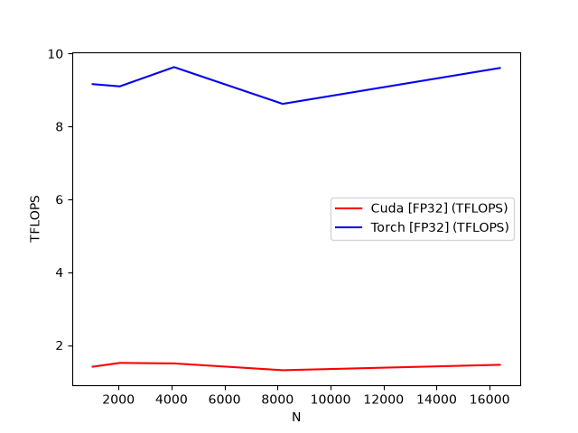
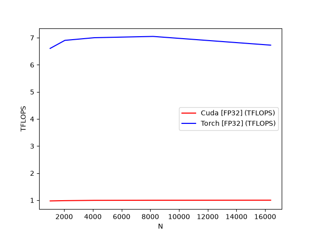

# CUDA Transformer: Bare-Metal GPT & FlashAttention-2

A from-scratch Transformer implementation where every core operation **including Flash-Attention 2 (forward and backward), GEMM, LayerNorm, GELU, and Softmax** is written directly in C++/CUDA (FP32) without relying on cuBLAS, cuDNN, or PyTorch's native C++ attention kernels.  
Built as a ground-up systems baseline to study GPU memory hierarchies, warp scheduling, shared-memory bank conflicts, and register tiling on NVIDIA's Blackwell architecture (sm_120).

> **Companion project:** The same GPT architecture accelerated with a register-tiled **Triton Flash-Attention 2** implementation (achieving 3.69×–6.07× speedups over this naive CUDA baseline and matching PyTorch SDPA at long sequence lengths): **<a href="https://github.com/AnshSachinkumarArora/FusedLM">FusedLM</a>**

## Highlights

- **From scratch CUDA Flash-Attention 2 (forward + backward)** implemented with 16 x 16 thread-block tiling (256 threads/block, head_dim = 64) in FP32, wired into PyTorch via a custom torch.autograd.Function C++/CUDA extension.   
- **Three-stage atomics-free backward pass:** decomposed into flash_attention_bwd_delta, flash_attention_bwd_dq, and flash_attention_bwd_dk_dv kernels to compute exact gradients without global atomicAdd contention.   
- **Hardware-level bottleneck diagnosis (ncu):** profiled down to SASS FFMA instruction counters, physical DRAM sector traffic, and warp stall reasons demonstrating why 83.0% achieved occupancy still plateaus at ~1.44 TFLOPS due to L1/shared-memory saturation (92.0%–95.4%) and __syncthreads() barrier stalls.   
- **End-to-end correctness verification** against torch.nn.functional.scaled_dot_product_attention and torch.autograd across causal and non-causal configurations.

| Component                                    | Status |
| :-------------------------------------       | :----: |
| CUDA Flash-Attention 2 (fwd/bwd)             |   ✅   |
| Custom CUDA Transformer Ops (GEMM, GELU, LN) |   ✅   |
| PyTorch autograd.Function C++ Extension      |   ✅   |
| Nsight Compute (ncu_report) Automated Parser |   ✅   |
| Register-Tiled Warp-Level Matrix Multiply    |   ⬜   |
| Shared-Memory Swizzling (Bank-Conflict Free) |   ⬜   |

## Results

### Setup

**GPU: RTX 5070 (sm_120)**   
**dtype: FP32**  
**Baseline: `torch.nn.functional.scaled_dot_product_attention`** 

### Throughput vs. sequence length
Benchmark config: **`dtype, B, H, N, D, causal = FP32, 4, 32, N ∈ {1024..16384}, 64, False`**.  
<br>**Forward Pass:**  



| N      | Custom CUDA FA2 (TFLOPS) | PyTorch SDPA (TFLOPS) | CUDA / SDPA |
| :----- | -----------------------: | --------------------: | ----------: |
| 1,024  | 1.41                     | 9.16                  | 0.15×       |
| 2,048  | 1.51                     | 9.10                  | 0.17×       |
| 4,096  | 1.50                     | 9.63                  | 0.16×       |
| 8,192  | 1.31                     | 8.62                  | 0.15×       |
| 16,384 | 1.46                     | 9.60                  | 0.15×       |

**Backward Pass:**  



| N      | Custom CUDA FA2 (TFLOPS) | PyTorch SDPA (TFLOPS) | CUDA / SDPA |
| :----- | -----------------------: | --------------------: | ----------: |
| 1,024  | 0.97                     | 6.61                  | 0.15×       |
| 2,048  | 0.98                     | 6.90                  | 0.14×       |
| 4,096  | 0.99                     | 7.00                  | 0.14×       |
| 8,192  | 1.00                     | 7.05                  | 0.14×       |
| 16,384 | 1.00                     | 6.73                  | 0.15×       |

### Kernel profiling (Nsight Compute)

Collected with `ncu --set full`. Run config: **`dtype, B, H, N, D, causal = FP32, 4, 32, 4096, 64, True`**. 

| Kernel                       | Duration  | SM throughput | Memory throughput | L1/TEX throughput | Achieved occupancy | Regs / thread | Static Shared Mem | Arithmetic Intensity |
| :--------------------------- | --------: | ------------: | ----------------: | ----------------: | -----------------: | ------------: | ----------------: | -------------------: |
| `flash_attention_fwd_kernel` | 212.73 ms | 53.04%        | 91.76%            | 91.99%            | 83.04%             | 40            | 17,536 B (17.1 KB)| 76.94 FLOPs/Byte     |
| `flash_attention_bwd_delta`  |   9.47 ms | 29.17%        | 26.89%            | 31.08%            | 53.86%             | 22            |    128 B (0.1 KB) |  0.16 FLOPs/Byte     |
| `flash_attention_bwd_dq`     | 348.42 ms | 37.08%        | 95.01%            | 95.36%            | 66.46%             | 40            | 23,680 B (23.1 KB)| 65.03 FLOPs/Byte     |
| `flash_attention_bwd_dk_dv`  | 901.43 ms | 47.01%        | 89.65%            | 89.70%            | 49.93%             | 56            | 27,776 B (27.1 KB)| 73.98 FLOPs/Byte     |

*"Memory throughput" is Nsight Compute's speed-of-light metric (the highest utilization across L1, L2, and DRAM). Arithmetic intensity is calculated directly from hardware `FFMA` instruction counters (`smsp__sass_thread_inst_executed_op_ffma_pred_on.sum.per_cycle_elapsed` x elapsed cycles x 2) divided by physical DRAM bytes transferred (`dram__sectors_op_read/write.sum` x 32).*

<details>
<summary><b>View raw output from <code>parse_ncu_report.py</code></b></summary>

```text
========================================
Analyzing Kernel: flash_attention_fwd_kernel
========================================
--- Speed of Light & Bottlenecks ---
Compute (SM) Throughput : 53.04%
GPU memory bandwidth Throughput: 91.76%
L1/TEX Cache Throughput : 91.99%

--- Occupancy & Divergence ---
Achieved Occupancy      : 83.04%
Registers Per Thread    : 40
Static Shared Mem (B)   : 17536

--- Warp Stalling Statistics ---
Memory Dependency Stall   : 257357.0 samples
Execution Pip Busy        : 28323.0 samples
Barrier Sync Stall        : 1935450.0 samples
Instruction Fetch Stall   : 47042.0 samples

--- Roofline Math ---
FMA Rate: 294.89223343373123
DRAM sector reads: 122303768.0 DRAM sector writes: 4001424.0
Total bytes: 4041766144.0
Total flops: 310960979968.0
Total FP32 FLOPs        : 310,960,979,968
Total DRAM Bytes        : 4,041,766,144
Arithmetic Intensity    : 76.94 FLOPs/Byte

========================================
Analyzing Kernel: flash_attention_bwd_delta
========================================
--- Speed of Light & Bottlenecks ---
Compute (SM) Throughput : 29.17%
GPU memory bandwidth Throughput: 26.89%
L1/TEX Cache Throughput : 31.08%

--- Occupancy & Divergence ---
Achieved Occupancy      : 53.86%
Registers Per Thread    : 22
Static Shared Mem (B)   : 128

--- Warp Stalling Statistics ---
Memory Dependency Stall   : 10998.0 samples
Execution Pip Busy        : 24809.0 samples
Barrier Sync Stall        : 165124.0 samples
Instruction Fetch Stall   : 8428.0 samples

--- Roofline Math ---
FMA Rate: 1.540964729902037
DRAM sector reads: 12949224.0 DRAM sector writes: 118184.0
Total bytes: 418157056.0
Total flops: 67108864.0
Total FP32 FLOPs        : 67,108,864
Total DRAM Bytes        : 418,157,056
Arithmetic Intensity    : 0.16 FLOPs/Byte

========================================
Analyzing Kernel: flash_attention_bwd_dq
========================================
--- Speed of Light & Bottlenecks ---
Compute (SM) Throughput : 37.08%
GPU memory bandwidth Throughput: 95.01%
L1/TEX Cache Throughput : 95.36%

--- Occupancy & Divergence ---
Achieved Occupancy      : 66.46%
Registers Per Thread    : 40
Static Shared Mem (B)   : 23680

--- Warp Stalling Statistics ---
Memory Dependency Stall   : 210937.0 samples
Execution Pip Busy        : 11920.0 samples
Barrier Sync Stall        : 1178632.0 samples
Instruction Fetch Stall   : 28193.0 samples

--- Roofline Math ---
FMA Rate: 242.15702289232547
DRAM sector reads: 202018720.0 DRAM sector writes: 5190280.0
Total bytes: 6630688000.0
Total flops: 431208005632.0
Total FP32 FLOPs        : 431,208,005,632
Total DRAM Bytes        : 6,630,688,000
Arithmetic Intensity    : 65.03 FLOPs/Byte

========================================
Analyzing Kernel: flash_attention_bwd_dk_dv
========================================
--- Speed of Light & Bottlenecks ---
Compute (SM) Throughput : 47.01%
GPU memory bandwidth Throughput: 89.65%
L1/TEX Cache Throughput : 89.70%

--- Occupancy & Divergence ---
Achieved Occupancy      : 49.93%
Registers Per Thread    : 56
Static Shared Mem (B)   : 27776

--- Warp Stalling Statistics ---
Memory Dependency Stall   : 539819.0 samples
Execution Pip Busy        : 43819.0 samples
Barrier Sync Stall        : 3029581.0 samples
Instruction Fetch Stall   : 119176.0 samples

--- Roofline Math ---
FMA Rate: 259.975565223987
DRAM sector reads: 470021912.0 DRAM sector writes: 8940056.0
Total bytes: 15326782976.0
Total flops: 1133904920576.0
Total FP32 FLOPs        : 1,133,904,920,576
Total DRAM Bytes        : 15,326,782,976
Arithmetic Intensity    : 73.98 FLOPs/Byte
```
</details>

### Cross-Repo Comparison: Custom Triton FA2 vs. Custom CUDA FA2 (FP32)

| Stage / Metric | Hand-Written CUDA (`16×16` tiles) | Triton FA2 (Register-Tiled) | Speedup / Delta |
| :--- | ---: | ---: | ---: |
| **Forward Pass (`fwd`)** | 212.73 ms (83.1% occ, 40 regs, 92.0% L1) | **57.58 ms** (8.3% occ, 255 regs, 56.9% L1) | **3.69× faster** |
| **Backward `delta`** | 9.47 ms (53.6% occ, 22 regs) | **0.45 ms** (15.7% occ, 82 regs) | **20.94× faster** |
| **Backward `dQ`** | 348.42 ms (66.5% occ, 40 regs, 95.4% L1) | **94.47 ms** (16.7% occ, 255 regs, 92.7% L1) | **3.69× faster** |
| **Backward `dK/dV`** | 901.43 ms (49.9% occ, 56 regs, 89.7% L1) | **148.49 ms** (16.7% occ, 128 regs, 80.3% L1) | **6.07× faster** |
| **Total Backward Pass** | 1,259.32 ms | **243.41 ms** | **5.17× faster** |

### Observations

- **The Occupancy Illusion (83.0% Occupancy vs. 92.0% L1 Thrashing):** The forward kernel achieves **83.04% occupancy** by keeping register pressure low (40 registers/thread) and static shared memory modest (17.5 KB/block). However, because each thread computes scalar 1D dot products directly out of shared memory rather than holding 2D sub-tiles in local registers, the kernel hammers the shared memory / L1 pipeline (**91.99% L1/TEX throughput** in `fwd`, **95.36%** in `bwd_dq`, and **89.70%** in `bwd_dk_dv`) while DRAM bandwidth sits idle (~3%).
- **Shared-Memory Bank Conflicts & MIO Queue Stalls:** Strided shared-memory loads across the 16 x 16 thread block trigger **4.3-way (`fwd`), 5.7-way (`bwd_dq`), and 3.9-way (`bwd_dk_dv`) shared-memory bank conflicts**, generating 68%–75% excessive shared wavefronts and stalling warps for 18.7–32.6 cycles per instruction waiting on the Memory Input/Output (MIO) queue.
- **Barrier Synchronization (`__syncthreads()`) Dominates Warp Stalls:** Across all four kernels, `Barrier Sync Stall` accounts for **78.9% to 85.3%** of the sampled stall events (`1,935,450` samples in `fwd` and `3,029,581` samples in `bwd_dk_dv`, compared to `257,357` and `539,819` memory dependency samples). Small 16 x 16 tiles force threads to hit `__syncthreads()` barriers every 16 elements along the sequence dimension, amplified by warp branch divergence (79.0%–84.7% branch efficiency) on causal boundary masks.
- **High Arithmetic Intensity is Necessary but Not Sufficient:** The attention kernels achieve high DRAM arithmetic intensities (**76.94 FLOPs/Byte** in `fwd`, **65.03 FLOPs/Byte** in `bwd_dq`, and **73.98 FLOPs/Byte** in `bwd_dk_dv`), proving that the FlashAttention tiling successfully keeps traffic off HBM. However, shifting the bottleneck from HBM to Shared Memory without register-level tiling simply trades a DRAM bottleneck for an L1/MIO ceiling at **1.44 TFLOPS** (fwd) and **0.99 TFLOPS** (bwd).

## Development notes

- **Uncoalesced Causal Loop in `bwd_dk_dv` Doubles Executed FLOPs:** Comparing hardware `FFMA` counters between this repository and the companion Triton implementation reveals that `flash_attention_bwd_dq` executes nearly identical math (**431.2 GFLOPs** in CUDA vs. **423.1 GFLOPs** in Triton, a `1.02×` ratio), whereas `flash_attention_bwd_dk_dv` executes **1,133.9 GFLOPs** in CUDA vs. **562.7 GFLOPs** in Triton (**2.02×** the FLOPs). While `bwd_dq` skips upper-triangular masked blocks, `bwd_dk_dv` iterates across all Q tiles before applying the causal mask inside the inner loop, computing the full N^2 attention matrix instead of starting the Q-tile loop at the causal diagonal.
- **Blackwell (`sm_120`) Hardware Counter Changes in `ncu_report`:** On Blackwell's Performance Monitoring Units (PMUs), Nsight Compute records instruction rates (`smsp__sass_thread_inst_executed_op_ffma_pred_on.sum.per_cycle_elapsed`) rather than cumulative `.sum` instruction counters to prevent counter overflow on long kernels, and renames physical DRAM sector counters to `dram__sectors_op_read.sum` and `dram__sectors_op_write.sum`. `parse_ncu_report.py` handles both naming conventions automatically.

## Repository layout

```text
├── assets/                    # benchmark plots (forward & backward TFLOPS sweeps)
├── benchmark/                 # throughput sweeps, ncu profiling script, report parser
├── cuda_autograd_fns/         # custom torch.autograd.Function wrappers for CUDA ops
├── cuda_transformer/          # compiled Pybind11 C++/CUDA extension package
├── dataset/                   # tokenized training data (generated by tokenizer.py)
├── gpt/                       # GPT model architecture and training loop
├── test/                      # pytest suite: FA2 & layer correctness vs. PyTorch reference & autograd
├── Transformer_kernels/       # raw CUDA (.cu) kernel implementations (FA2 fwd/bwd, GEMM, GELU, LN)
├── Transformer_launchers/     # C++/CUDA host launcher functions and PyTorch C++ bindings
├── pyproject.toml             # build system configuration and metadata
├── requirements.txt           # Python dependencies
├── setup.py                   # setuptools entrypoint to compile and install cuda_transformer
└── tokenizer.py               # BPE dataset tokenization into memory-mapped binary files
``` 

## Setup

**Requirements:** an NVIDIA GPU and the CUDA Toolkit (`nvcc` and Nsight Compute for profiling). Developed and tested on an RTX 5070 (`sm_120`).

1. Install Python dependencies and compile the custom CUDA extensions:
   ```bash
   pip install -r requirements.txt
   pip install -e . --no-build-isolation
   ```

### Test the CUDA kernels

```bash
pytest -v test/
```

### Run End-To-End CUDA GPT Training Loop

```bash
cd gpt
python gpt.py
```


### Benchmark

Run the FP32 sequence-length throughput sweep against PyTorch SDPA:

```bash
cd benchmark
python cuda_bench.py
```

Collect hardware counters with NVIDIA Nsight Compute and parse the `.ncu-repz` report (`parse_ncu_report.py` requires Nsight Compute's `extras/python` directory on `PYTHONPATH`):

```bash
cd benchmark
ncu -f --profile-from-start off --set full -o cuda_fa2_profile python cuda_fa2_ncu_profiler.py
python parse_ncu_report.py --report_path cuda_fa2_profile.ncu-repz
```

---

## Roadmap

- [ ] Advance the starting Q-tile index to the causal diagonal in `flash_attention_bwd_dk_dv` to eliminate the 2x redundant upper-triangle FLOPs
- [ ] Implement 2D register tiling (increasing per-thread register blocking) to shift operand reuse from Shared Memory into the register file and relieve the 92%–95% L1/TEX bottleneck
- [ ] Pad or swizzle shared-memory tiles to eliminate the 3.9–5.7-way bank conflicts
- [ ] Add `FP16` / `BF16` WMMA / MMA Tensor Core kernels to compare against Triton's `tl.dot` pipeline

---

## References

- Dao, *FlashAttention-2: Faster Attention with Better Parallelism and Work Partitioning* — https://arxiv.org/abs/2307.08691
- Dao et al., *FlashAttention: Fast and Memory-Efficient Exact Attention with IO-Awareness* — https://arxiv.org/abs/2205.14135
- NVIDIA Corporation, *CUDA Programming Guide* — https://docs.nvidia.com/cuda/cuda-programming-guide/index.html
- NVIDIA Corporation, *CUDA C++ Best Practices Guide (Shared Memory & Bank Conflicts)* — https://docs.nvidia.com/cuda/cuda-c-best-practices-guide/
- NVIDIA Corporation, *Nsight Compute CLI & Python Report Interface (`ncu_report`)* — https://docs.nvidia.com/nsight-compute/
- Triton documentation — https://triton-lang.org/main/index.html
- nanoGPT by Andrej Karpathy — https://www.youtube.com/watch?v=kCc8FmEb1nY
- The Illustrated Transformer — https://jalammar.github.io/illustrated-transformer/